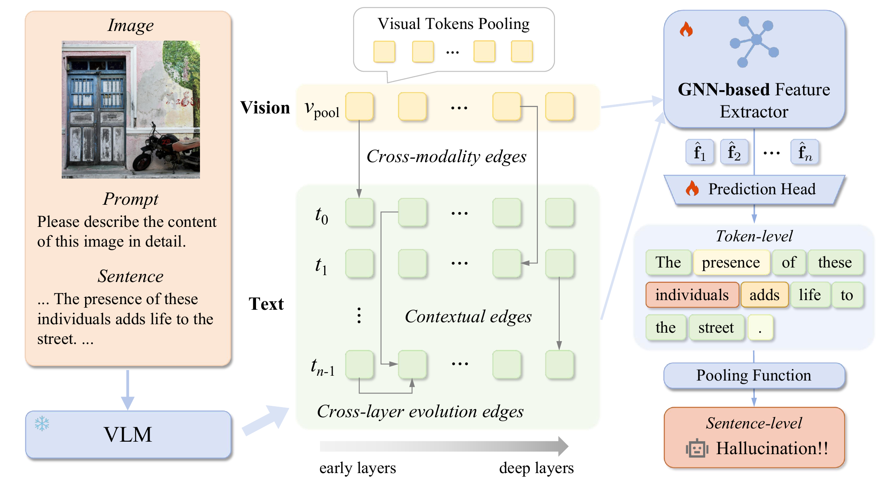
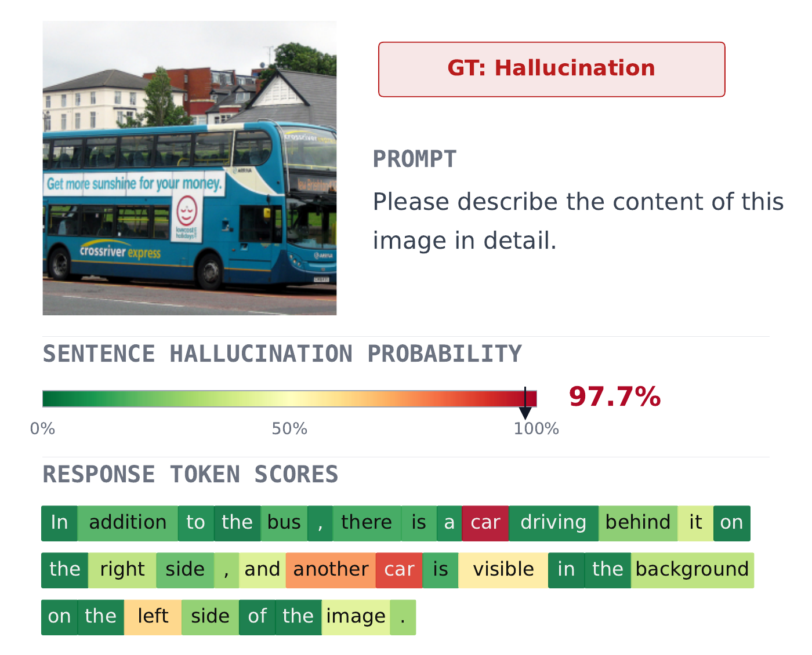
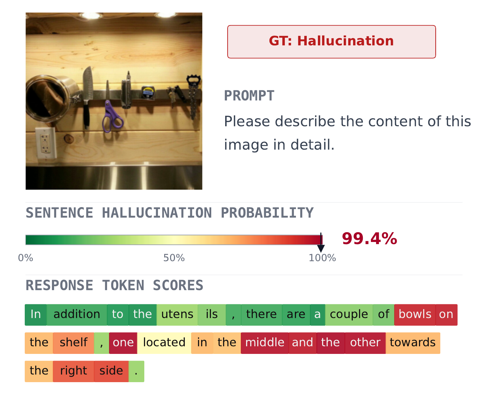

<div align="center">

<h1>TRACE: Cross-Layer Evolution Graph Learning for Fine-grained VLM Hallucination Detection</h1>

<p>Shaoxuan Li &nbsp;&nbsp; Shiliang Zhang<sup>*</sup></p>
<p>State Key Laboratory of Multimedia Information Processing<br>School of Computer Science, Peking University</p>

<p>
  <a href="https://neurips.cc/virtual/2026/poster/150184"></a>
  <a href="#quick-start"></a>
  <a href="LICENSE"></a>
</p>

<p>
  <a href="#news">News</a> ·
  <a href="#overview">Overview</a> ·
  <a href="#results">Results</a> ·
  <a href="#quick-start">Quick start</a> ·
  <a href="#data">Data</a> ·
  <a href="#citation">Citation</a>
</p>

</div>

**TRACE** (**T**oken **R**epresentation **A**nalysis with **C**ross-layer **E**volution) detects VLM hallucinations by learning how token representations evolve across layers, and localizes risky tokens using sentence-level supervision.

## News

- **2026-09** — TRACE has been accepted to **NeurIPS 2026**! [Conference page](https://neurips.cc/virtual/2026/poster/150184).

## Overview

<p align="center">
  
</p>

**Overview of our framework..** A frozen VLM supplies hidden states and attention maps for graph construction. Relation-specific message passing captures cross-layer dynamics, and token-first MIL produces token risk scores and a sentence-level hallucination prediction.

- **Cross-layer graph learning:** connect token evolution, contextual dependencies, and visual grounding in one heterogeneous graph.
- **Dual-granularity prediction:** train with sentence labels and obtain both response-level detection and token-level localization.
- **Cross-domain transfer:** train on M-HalDetect and evaluate on ViGoR across multiple VLM backbones.

### Localization examples

<table>
  <tr>
    <td align="center" width="50%"><br><b>LLaVA-1.5</b></td>
    <td align="center" width="50%"><br><b>Qwen3-VL</b></td>
  </tr>
</table>

Examples of hallucination localization. Warmer token colors indicate higher hallucination risk; the sentence-level score summarizes the response.

## Results

Results reported in the paper. Higher is better for both AUPR and F1.

### Sentence-level detection

M-HalDetect is the source domain and ViGoR is the OOD target domain (Table 1).

| Backbone | M-HalDetect AUPR | ViGoR AUPR |
|---|---:|---:|
| LLaVA-1.5 | 0.80 | 0.71 |
| Qwen-VL | 0.81 | 0.72 |
| Qwen3-VL | **0.85** | **0.77** |

### Token-level localization

HalLoc overall token F1 with LLaVA-1.5 representations and **sentence-level supervision** (Table 3).

| VQA | Instruct | Caption |
|---:|---:|---:|
| **0.79** | **0.68** | **0.42** |

## Quick start

### Environment

Use a Python environment with PyTorch and PyTorch Geometric. For GPU use, install the PyTorch build suitable for your CUDA environment before the remaining dependencies.

```bash
python -m venv .venv
source .venv/bin/activate
python -m pip install -r requirements.txt
```

VLM extraction uses Transformers 4.57.6. Use `--model_path /path/to/local/weights` to load local backbone weights; run the extraction command with `--help` for supported model types and options.

### Data

Run commands from the repository root. Prepare JSONL annotations with `image_path`, `prompt`, `response`, and binary `label` (`1` means hallucination). Preserve the benchmark's train/validation/test assignments.

```json
{"image_path":"example.jpg","prompt":"Please describe the content of this image in detail.","response":"A person is standing beside a bicycle.","label":0}
```

Relative image paths resolve under `--image_dir`. Extract each split into `data/graphs/train`, `data/graphs/val`, or `data/graphs/test`. Each directory contains the generated `graph_*.pt` files. `python scripts/prepare_data.py --help` describes conversion options for exported M-HalDetect and ViGoR annotations.

### 1. Extract graphs

```bash
python src/graph_builder/run_extraction.py \
  --model_type llava-1.5-7b \
  --annotation_file data/annotations/train.jsonl \
  --image_dir data/images \
  --output_dir data/graphs/train \
  --device cuda:0
```

Repeat for validation and test annotations, using `data/graphs/val` and `data/graphs/test`. Use the same VLM, layer schedule, and graph configuration for all splits. By default, extraction samples eight layers and uses contextual threshold `0.05` and visual top-k `5`.

### 2. Train the MIL detector

```bash
python src/train.py --data_root data/graphs --output_dir runs/trace
```

The default loss is **sentence-level BCE**. The best checkpoint is selected using validation sentence AUPR.

| Parameter | Default |
|---|---:|
| Readout / MIL sharpness `r` | MIL / 0.5 |
| Sampled VLM layers / GNN layers | 8 / 8 |
| Hidden dimension / attention heads | 256 / 4 |
| Dropout | 0.1 |
| Batch size / epochs | 32 / 20 |
| Optimizer | AdamW |
| Learning rate / minimum rate | 0.002 / 0.00002 |
| Weight decay / max gradient norm | 0.0001 / 1.0 |
| Schedule | cosine annealing |

Training defaults to 20 epochs within the paper’s 15–20 epoch range, with seed 42. All options are available through `--help`.

### 3. Evaluate

```bash
python src/evaluate.py \
  --checkpoint runs/trace/best.pt \
  --data_root data/graphs --split test \
  --output_dir runs/trace/test
```

Evaluation restores the architecture and MIL temperature from the checkpoint. It reports trapezoidal precision–recall AUC (`aupr`), average precision, AUROC, and Best F1 (`best_f1`). Fixed-threshold F1, precision, recall, and accuracy are also reported, with a default threshold of `0.5`.

For the paper’s OOD protocol, train and select checkpoints on M-HalDetect, then evaluate on ViGoR graphs.

## HalLoc localization

The HalLoc extractor preserves full responses and aligns annotation spans to response tokens:

```bash
python src/graph_builder/build_halloc_graphs.py \
  --model_type llava-1.5-7b \
  --halloc_file data/source/halloc_caption.json \
  --image_dirs data/images/VG_100K data/images/VG_100K_2 \
  --task caption --data_split train --save_root data
```

Repeat for `val` and `test`. The input is a JSON array with `id`, `image_id`, `split`, `prompt`, `hallucinated_text`, and `annotations`; the supported tasks are `caption`, `instruct`, and `vqa`. Annotation spans use half-open character offsets into `hallucinated_text`, for example `{"object":[{"obj":{"char_index":"2:5"}}]}`.

Use the generated `data/halloc/llava-1.5-7b/caption` directory as the graph root. Multiple graph roots can combine M-HalDetect and HalLoc sentence labels when the graph/backbone settings match:

```bash
python src/train.py \
  --data_root data/graphs data/halloc/llava-1.5-7b/caption \
  --output_dir runs/trace-localization

python src/evaluate.py \
  --checkpoint runs/trace-localization/best.pt \
  --data_root data/halloc/llava-1.5-7b/caption --split test --token_eval \
  --output_dir runs/trace-localization/test
```

`--category object|attribute|relationship|scene` selects a category when the corresponding extracted directories exist. By default, token Best F1 pools tokens from hallucinated responses. Use `--token_scope all` to include factual responses. The evaluation scope is recorded in the output.

The paper's explicitly token-supervised upper bound is available as a separate opt-in fine-tuning run:

```bash
python src/train.py \
  --data_root data/halloc/llava-1.5-7b/caption \
  --supervision token --init_checkpoint runs/trace-localization/best.pt \
  --output_dir runs/trace-token-supervised
```

The `token` supervision mode trains with token labels and reports token-level validation metrics.

## Repository

```text
src/graph_builder/   VLM extraction, graph edges, and HalLoc alignment
src/models/          heterogeneous GNN, MIL, and attention readout
src/dataset.py       explicit benchmark splits and graph validation
src/train.py         sentence MIL training and opt-in token supervision
src/evaluate.py      sentence and token evaluation
scripts/prepare_data.py  annotation normalization
assets/              pipeline and localization figures
```

## Citation

```bibtex
@inproceedings{li2026trace,
  title={Cross-Layer Evolution Graph Learning for Fine-grained VLM Hallucination Detection},
  author={Li, Shaoxuan and Zhang, Shiliang},
  booktitle={Advances in Neural Information Processing Systems},
  year={2026},
  url={https://neurips.cc/virtual/2026/poster/150184}
}
```

## License

Code is released under the [MIT License](LICENSE). Backbone models and datasets retain their respective licenses.